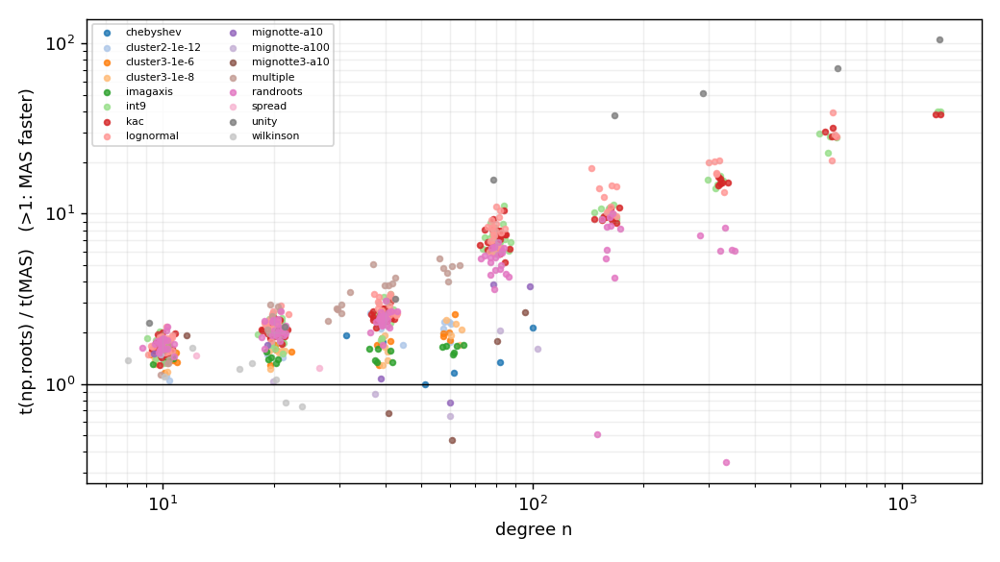

# certiroot

**Certified, correctly rounded polynomial roots with exact multiplicities. Faster than `numpy.roots`.**

[](https://github.com/arturcastiel/certiroot/actions/workflows/ci.yml)
[](LICENSE)


```python
>>> import numpy as np, certiroot
>>> c = np.poly([0.5] * 4)            # (x - 0.5)**4, coefficients exact in double
>>> np.roots(c)
array([0.50010958+0.j        , 0.49999999+0.00010957j,
       0.49999999-0.00010957j, 0.49989044+0.j        ])
>>> certiroot.roots(c)
array([0.5, 0.5, 0.5, 0.5])
>>> certiroot.distinct_roots(c)
(array([0.5+0.j]), array([4]))
>>> float(np.roots([1, 0, -2])[1])          # sqrt(2) = 1.4142135623730951...
1.414213562373095
>>> float(certiroot.roots([1, 0, -2])[1])
1.4142135623730951

```

## What you get

Take the polynomial whose coefficients are *exactly* the doubles you pass in. certiroot returns:

- **Correctly rounded roots.** Every real and imaginary part is the double nearest to the true root. The one exception is a component tiny next to the root (|component| ≤ 2⁻¹¹⁹·|z|, e.g. a real part that may be exactly zero), which is accurate to within that bound.
- **Exact multiplicities**, not a cloud of nearby approximations.
- **Certified results.** Each root is isolated by a rigorous inclusion disc before it is rounded.
- **Speed.** Every stage is Θ(n²), while numpy's companion-matrix eigenvalue approach is Θ(n³).

## Benchmark

558 polynomials in 16 families (Kac, integer, log-normal, roots of unity, Wilkinson, Chebyshev,
Mignotte close pairs, clusters, multiple roots, …), n = 8 – 1280, scored against certified
[Arb](https://arblib.org) enclosures. Full method, statistics and caveats: [`study/REPORT.md`](study/REPORT.md).

| | `np.roots` | **certiroot** |
|---|---|---|
| polynomials with all roots correctly rounded | 0 / 558 | **558 / 558** |
| polynomials with a root off by > 10⁻⁶ (relative) | 125 | **0** |
| multiplicities | not reported | **exact, 558 / 558** |
| faster on | 10 / 558 | **548 / 558** |
| speed, geometric mean | 1× | **2.86× faster** |
| speed, n ≥ 80 | 1× | **10× faster** |
| Kac polynomial, n = 1280 | 1.81 s | **47 ms** |

certiroot is also 31× faster than MPSolve, which is certified but not correctly rounded. numpy is
never both faster and as accurate. The 10 cases where it is faster are ill-conditioned inputs, where
its relative errors range from 3.5·10⁻⁸ to 2.3.



*One machine (i7-1355U, single thread). See the report for the threats to validity.*

## Install

You need a C++17 compiler (gcc or clang, 64-bit) and the [GMP](https://gmplib.org) library with headers.

```bash
sudo apt install libgmp-dev          # Debian/Ubuntu;  macOS: brew install gmp
pip install git+https://github.com/arturcastiel/certiroot
```

The build tunes for the machine it runs on (`-march=native`). For a portable binary, set
`CERTIROOT_ARCH=none` or a specific target such as `x86-64-v3`. A build without FMA
(`x86-64-v2`) measured 1.5–3.4× slower. To use a GMP outside the system paths, set `GMP_DIR` (a prefix containing
`include/` and `lib/`), or set `GMP_INCLUDE_DIRS` and `GMP_LIBRARY`.

## API

| function | returns |
|---|---|
| `roots(p)` | Drop-in for `np.roots`. Coefficients highest degree first; every root repeated by multiplicity, sorted. Real dtype when all roots are real. |
| `polyroots(c)` | The same with coefficients lowest degree first (`numpy.polynomial` convention). |
| `distinct_roots(p)` | `(z, m)`: the distinct roots and their exact multiplicities. |
| `solve_raw(p, version=2)` | Unsorted low-level output plus status flags. `version=1` is the original MAS design. |

Input must be real and finite. NaN, infinity, the zero polynomial or a nonzero imaginary part raise
an error instead of returning garbage. The GIL is released while solving, so calls from several
threads run in parallel. The rare multiprecision fallback is the exception: it runs one call at a time.

## How it works

certiroot is the compiled form of **MAS**, Artur Castiel's polynomial solver
([`prototype/`](prototype)). The original design used Sturm chains plus a winding-number quadtree;
it survives as the `version=1` fallback. The default path is:

1. **Square-free test modulo 2⁶¹−1.** It is exact and cheap. Only when repeated roots exist does it
   run a multi-modular square-free decomposition, with an exact GMP GCD as fallback. That is what makes
   the multiplicities exact.
2. **Aberth–Ehrlich iteration** (cubic convergence, Θ(n²) per sweep), started from Bini's
   Newton-polygon circles.
3. **Compensated (double-double) Newton polish.**
4. **Certification.** Gershgorin-type inclusion discs, per-root error bounds and conjugate symmetry.
5. **Correct rounding** of every component with a rigorous error bound.

Roots that double-double evaluation cannot separate escalate locally: first to K-fold compensated
evaluation, then to an exact Taylor shift around a cluster anchor, then to multiprecision. Only the hard roots pay
for this.

## Limitations

- **Real float64 coefficients only.** `np.roots` also accepts complex input.
- **Linux and macOS with gcc or clang.** MSVC, 32-bit and WebAssembly are not supported yet, because the code uses `__int128` and GCC builtins.
- **No time bound.** Coefficients spanning more than ~10¹⁹⁰ at high degree fall back to slow multiprecision. One example: c_k = N(0,1)·1.7⁻ᵏ at n = 2000 did not finish within 300 s.
- **GMP (LGPL) is linked dynamically.** That is fine for this package, but [`docs/UPSTREAM.md`](docs/UPSTREAM.md) covers what it means for a future SciPy contribution.

## Repository

| path | contents |
|---|---|
| `csrc/mas.cpp` | the solver (C++17 + GMP, C ABI) |
| `src/certiroot/` | Python package (ctypes binding) |
| `tests/` | pytest suite. The Arb correct-rounding checks run when `python-flint` is installed. |
| `study/` | the reproducible benchmark: harness, raw timings, analysis, plots, report |
| `prototype/` | the original Python MAS, the patched version and their stress tests |
| `docs/UPSTREAM.md` | what it would take to propose this to NumPy or SciPy |
| `patches/` | experimental Dekker fallback for CPUs without FMA (bit-identical results) |

```bash
pip install .[test] && cd tests && pytest
```

## Roadmap

A GMP-free core, portable builds (MSVC, wasm), a time budget for the multiprecision fallback, complex
coefficients, wheels, and a write-up of the method. The plan and its reasoning are in
[`docs/UPSTREAM.md`](docs/UPSTREAM.md).

## Development note

MAS, the idea and the original Python prototype, is by Artur Castiel. The C++ implementation,
tests and benchmark study were developed under his direction with substantial help from an AI coding
assistant (GitHub Copilot CLI). This note is here because NumPy and SciPy require such disclosure
for contributions.

## License

BSD 3-Clause, see [LICENSE](LICENSE). certiroot links dynamically against GMP, which is
LGPL-3.0-or-later / GPL-2.0-or-later.
